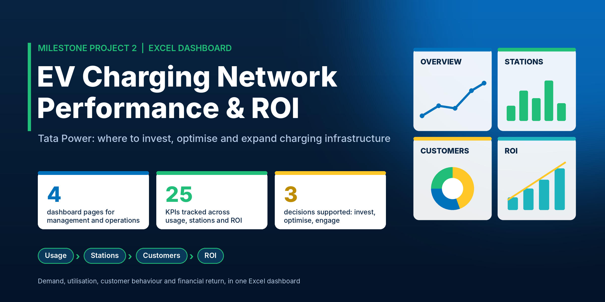

<h1 align="center">Tata Power — EV Charging Network Performance & ROI Dashboard</h1>

<p align="center">
  
  
  
  
</p>

<p align="center">
  
</p>

## Overview

A four-page Excel dashboard for evaluating the performance, profitability and expansion potential of Tata Power's electric vehicle charging infrastructure across districts. It combines operational data, customer usage and financial ROI metrics for senior management, strategy teams and operations managers, to answer:

- Is charging demand growing, and can stations handle it?
- Which stations are overused (need capacity) and which are underused (need improvement)?
- Which customers and segments drive usage and revenue, and which have high potential but low engagement?
- Which districts and projects return the most, how long is the payback, and where should new stations go first?

## KPIs Tracked

| Page | KPIs |
|---|---|
| 1. Business and Usage Overview | Total charging sessions · Total energy consumed (kWh) · Total revenue · Active customers · Average revenue per session · Average kWh per session |
| 2. Station Utilization and Operational Efficiency | Sessions per station · Average utilization (sessions per plug) · Plug count vs actual usage · Average kWh per station · District-wise station density · Sessions-per-plug ratio |
| 3. Customer and Demand Behavior | Unique customers · Sessions per customer · Average kWh per customer · Revenue per customer · Usage by income tier · Usage by car model and battery capacity |
| 4. Financial Performance and Expansion Strategy | CAPEX per project · Annual revenue and EBITDA · Payback period (with and without subsidy) · 5-year ROI % · Existing stations vs projected EVs · Demand-supply gap (projected EVs vs projected plugs) · Priority tier |

*KPI values are not listed here because they come from the dataset. All KPIs are intended to update through slicers (for example district and time period).*

## Tech Stack

```
Microsoft Excel
├── Power Query      → Data ingestion and cleaning
├── Data Model       → Linking session, station, customer and project data
├── Pivot Tables     → Multi-dimensional analysis behind every chart
├── Pivot Charts     → Interactive visuals
└── Slicers          → Filters such as district and time period
```

*Adjust this block to the tools you actually used (for example Power Pivot and DAX measures, if applicable).*

## Pages Inside the Dashboard

| Page | Business questions answered |
|---|---|
| **1. Business and Usage Overview** | How is charging demand evolving over time? Can stations handle growing demand? What does charging behaviour look like by time of day? |
| **2. Station Utilization and Operational Efficiency** | Which stations are overutilized and may need capacity expansion? Which are underutilized and need operational improvement? Are plugs used efficiently across locations? How is load distributed across districts and stations? |
| **3. Customer and Demand Behavior** | Which customer types contribute most to usage and revenue? How does income tier influence charging? What are the usage patterns across EV models and battery capacities? Which segments have high potential but low engagement? |
| **4. Financial Performance and Expansion Strategy** | Which districts and projects deliver the highest ROI? What is the payback period for different setups? How do CAPEX, land lease and infrastructure costs affect profitability? Where should new stations be prioritised, and what is the gap between current infrastructure and projected EV demand? |

## Decisions the Dashboard Supports

| Decision | Page |
|---|---|
| Where to add capacity or new stations | 2 and 4 |
| How to improve underperforming stations | 2 |
| How to grow customer engagement and target high-potential segments | 3 |
| Where to invest first to maximise ROI | 4 |
| How pricing may need to change by time of day or segment | 1 and 3 |

## How to Use

1. Clone or download this repository.
2. Open `Tata_Power_EV_Dashboard.xlsx` in Microsoft Excel (2016 or later recommended).
3. Move between the four dashboard pages using the tabs.
4. Use the slicers to filter by district, time period and other fields.
5. All KPIs and charts update automatically.

## Repository Structure

```
tata-power-ev-charging-dashboard
├── Tata_Power_EV_Dashboard.xlsx    ← Main workbook (dashboard pages + pivot tables + data) (add your file here)
├── Dashboard.png                   ← Dashboard screenshot (optional)
├── cover.png                       ← Repo cover image
└── README.md
```

---

## About Me

**Anmol Agarwal**
Business Analyst

[](https://www.linkedin.com/in/anmol-agarwal123/)
[](https://github.com/Anmolagarwal19)
[](mailto:agarwalanmol799@gmail.com)

*If this project was useful, a star on the repo is appreciated — feel free to reach out for feedback, questions, or opportunities.*
